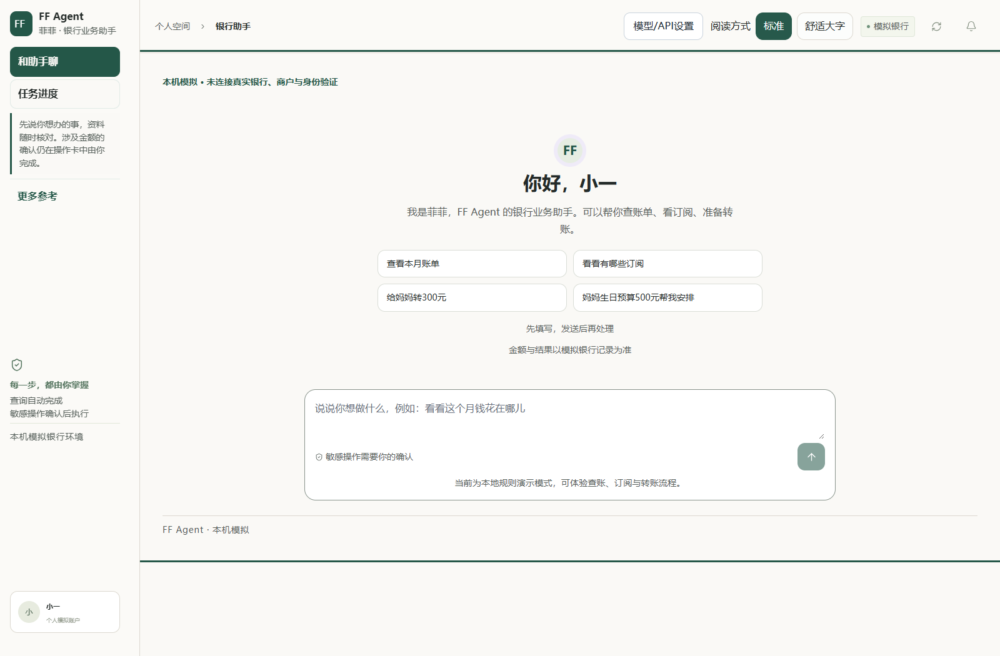

# FF Agent · 银行智能助手

FF Agent（助手昵称“菲菲”，无性别）是以连续对话为入口的PC端银行助手。用户描述目标，助手读取账单、账户与业务回执，分解任务并准备下一步；资金操作由用户本人明确确认，按风险完成验证。

**当前为本机模拟银行原型。未连接真实银行、商户、短信/人脸验证或外部APP/IM。** 页面不会把模拟结果当作真实转账、退款或配送。

## 参赛材料

| 材料 | 文件 |
| --- | --- |
| 作品简介（200字以内） | [项目简介](docs/项目简介.md) |
| 系统架构、算法与安全设计 | [技术文档](docs/技术文档.md)，[PDF](materials/技术文档.pdf) |
| 权限分级与已知风险 | [安全自评](docs/安全自评.md)，[PDF](materials/安全自评.pdf) |
| 答辩PPT，讲述计划8分钟 | [答辩材料](materials/答辩.pptx) |
| 测试与复现 | [测试说明](docs/测试与复现.md) |

## 一段对话办完目标

- **生日安排**：说清对象、日期与预算，选择模拟鲜花或蛋糕，分别确认预算预留与订单付款。预算500元、花费300元后，余下200元仍预留，不冒称退款。
- **账单与续费整理**：查询月度/年度账单，查看异常候选；单独同意查询订阅，再逐项确认停止后续续费。取消续费不等于退款。
- **安全恢复**：目标可暂停、恢复或明确切换；结果未知时仅核对原请求，不重发、不取消、不释放预留。

转账、账单、理财、卡片、订阅与生日联动均有本机子集。另含整数分AA分摊、显式到期的定时授权、演示投资测评与比较、卡片限额/交易锁、模拟消费、本人笔记记忆、受控演示操作员及渠道收件箱。持续目标目前限生日和账单续费两类，不承诺任意任务。

## 当前界面

首页以与菲菲的对话为中心，空态显示简洁的欢迎语、示例与输入框；有真实目标或待办时才显示右侧任务栏。示例只填入草稿，已有文字时先询问保留还是替换，发送失败也会保留期间新写的草稿。待办按真实状态显示“等待确认”“等待验证”或“结果待核对”；点“定位”只跳到原操作卡，不会确认或执行。阅读旧消息时保留当前位置，新回复通过“回到最新消息”入口提示。

支持“给妈妈转三百块”“改成两百块钱”等明确金额，仍只准备操作，须本人确认；多金额或外币混杂先澄清。生日目标在尚未选择商品和预留资金前，可说“预算改成600元”重新筛选；预算含糊时重新询问，已准备、暂停或未知操作不会直接改金额。

页面顶部可展开本机模拟环境说明。右上角“模型/API设置”把密钥保存到服务器本机`.env`，重启后生效；同一位置可切换标准与舒适大字阅读模式。

- 账单、账户等参考资料收在“更多参考”折叠入口中，展开与导航本身不会发起业务操作，原有操作仍在对应页面单独确认。



## Windows 一键启动包

GitHub“下载源码ZIP”不包含运行环境；一键启动需使用单独提供的Windows便携ZIP。

便携包面向 Windows 10/11 x64，自带 Python 运行环境、依赖与已构建页面。解压整个文件夹后双击 **启动FF-Agent.cmd**，会在默认浏览器打开本机页面；无需另装 Python、Node.js，也不需要运行 pip 或 npm。首次启动使用独立端口18765，不替换已有8765服务；遇到冲突会停止并提示，不会终止其他程序。详细步骤见[便携版使用说明](便携版使用说明.txt)。

公开包不包含任何真实密钥，默认规则演示；模型/API设置中可配置自己的 DeepSeek 官方密钥。个人配置包仅供本人保管，不能上传到公开仓库或转发。

## 快速运行

需要Python 3.12、Node.js 22或以上版本（建议与锁文件相同环境）。在仓库根目录执行：

```powershell
python -m venv .venv
.venv/Scripts/python.exe -m pip install -r requirements.lock.txt
.venv/Scripts/python.exe -m pip install -r requirements-wasm.lock.txt
Copy-Item .env.example .env
cd frontend
npm ci
npm run build
cd ..
.venv/Scripts/python.exe scripts/launch.py
```

Windows也可在安装与构建完成后双击 `启动FF-Agent.cmd`。启动器只复用来源与构建一致的本机服务，不自动替换已有进程。若8765已被其他版本占用，在`.env`中设置另一个空闲`FF_PORT`，再自行启动。

首次运行生成本机演示数据库；官方DeepSeek地址和`deepseek-flash`模型已预填，无需密钥即可体验规则模式。初始演示用户与账户均为模拟数据。不要把真实客户数据或服务密钥提交到仓库。

## 可选模型接入

默认`FF_PLANNER_MODE=rules`、`FF_CODEGEN_MODE=off`。自然语言模型与受限计算生成均由服务器显式配置；业务对话不接受模型地址或密钥；设置入口经过单独校验，只保存下次启动配置。首页右上角有“模型/API设置”，默认服务为DeepSeek官方、模型为`deepseek-flash`；密码框只录入、不回显，保存到服务器本机`.env`，重启后生效。详见[配置说明](docs/配置说明.md)。

模型只负责有限规划或生成纯计算程序，不能批准转账、替代本人确认或提高金融权限。受限WASM计算与真实银行沙箱是不同环境。

## 测试

```powershell
$env:PYTHONPATH="backend"
.venv/Scripts/python.exe -X utf8 -m pytest backend/tests -q
cd frontend
npm test
npm run build
```

测试状态以[测试与复现](docs/测试与复现.md)记录为准。合成场景和本机回归不代表现实反诈准确率。

## 技术边界与组件

- 后端：Python、FastAPI、SQLite事务与整数分账本。
- 前端：React、TypeScript、Vite，PC端普通与大字阅读模式。
- 记忆：本人明确保存的笔记、会话工作槽、版本与归属校验。记忆内容不会变成操作授权。
- 计算：Wasmtime无宿主导入、有限资源、来源绑定与一次性执行标识。

第三方依赖见[组件说明](THIRD_PARTY_NOTICES.md)。本仓库未指定项目级开源许可证，第三方组件仍适用各自许可。
