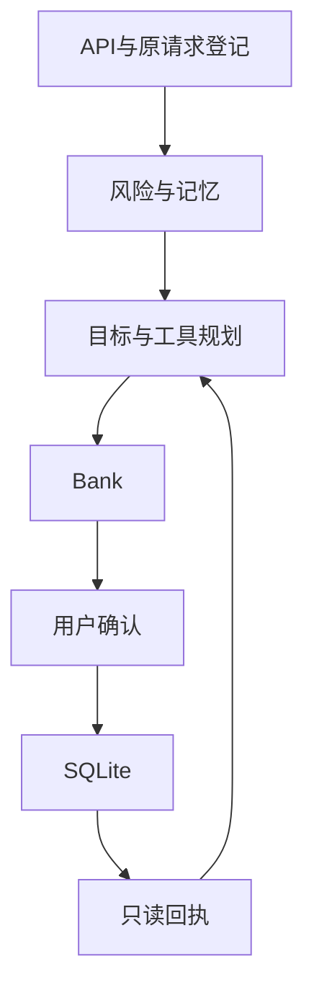

# 菲菲 技术文档

提交版标识：20261028。本机模拟原型，账户、订单和验证均为演示。

## 使用场景

菲菲是PC端银行助手。用户可以在连续对话中提出目标，例如“给妈妈安排明天生日，预算500”，或“看本月账单，整理不需要的自动续费”。菲菲会读取本机Bank的真实结果，再准备下一步，由用户独立确认，并按风险完成验证。菲菲自己从不批准资金操作。

## 架构

| 层 | 职责 | 边界 |
|---|---|---|
| API/登记 | current_user、CSRF/Origin | 业务对话不能携带密钥或地址 |
| 风险/记忆 | 规则判定与本人记忆 | 不保存密钥 |
| 目标/工具 | 有限规则控制器 | 不做通用DAG |
| Bank | 整数分记账与事务 | 模拟商户 |
| 用户确认 | 独立确认与绑定验证 | 菲菲不批准 |
| SQLite | 持久化与幂等 | 本机 |
| 只读回执 | 原键GET核对 | 不重发POST |

## 目标与记忆

目标控制器是有限的确定性规则，不在每轮都调用LLM。可选白名单内的模型规划。目标支持暂停、恢复和明确切换，同一焦点只有一个目标。UNKNOWN状态只读，浏览器仅保存控制请求的不透明原键，刷新后只GET，不会POST。页面刷新或暂停恢复后旧验证码清空，已保存的暂停目标操作卡只读。

生日目标有持久节点，鲜花和蛋糕分支共享预算预留和现金账，订单为模拟。例如预算500、已付300，剩余200继续预留。

记忆按精确ID、本人完整集合和唯一子串检索，并做版本校验。工作槽最长600秒，近期上下文最多6段；长期记忆只记用户明确要求的笔记，不保存秘密，也不会因年龄放宽权限。

## 资金与风险

- 金额用整数分，支持重放和预留。日累计额度把在途金额算在内。
- 绿：本人余额、账单等只读查询。黄：当日累计（含待处理）转账不超过1000元、订阅查询/取消等需明确确认。红：超过1000元的累计转账、挂失/解挂、模拟理财等还需绑定操作的演示验证。
- UNKNOWN：保留原状态，不取消、不重试。

## 其他有界业务

| 方向 | 已实现子集 | 未接 |
|---|---|---|
| 智能转账 | 已知收款人、定时授权、AA整数分摊 | 真实银行、常驻调度 |
| 账单分析 | 月度/年度分类与异常提示 | 真实银行数据 |
| 理财操作 | 问卷、产品对比、模拟申赎 | 实时行情与真实产品 |
| 卡片管理 | 挂失/解挂、限额、交易锁、模拟消费和演示口令 | 真实卡申请/卡组织 |
| 订阅代扣 | 查询授权、续费提醒、分别确认取消 | 需商户办理的真实退订 |
| 跨场景联动 | 生日预算、鲜花/蛋糕分支、模拟订单 | 真实商户与配送 |

## WASM与来源

I3使用受限Wasmtime worker：无imports，固定i64导出；fuel 100k、线性内存1MiB、进程256MiB、CPU 2s、wall 5s、输出4096B。结果只作算术参考。可选WAT生成默认未连接，只有服务器显式注入时才可用。生成能力由服务器显式开启；未配置时页面显示未连接。

## 模型接入

首页提供按需打开的“模型/API设置”。DeepSeek官方模型通过现有Chat Completions规划器接入，返回动作仍须通过本地白名单和银行权限校验。配置保存在服务器本机.env中，密钥只录入不回显，不保存在浏览器；显式启用、本人demo会话、CSRF/Origin和固定HTTPS地址约束后才可保存，重启后生效。

## 验证

完整银行后端回归2614项通过、1项跳过（首页设置模块加入前）；设置模块32项通过、1项因Windows无法创建符号链接而跳过；集成后API、会话、规划与目标相关回归121项通过。以上测试组存在重叠，不能相加。全部前端500项通过，TypeScript与Vite构建通过。具体命令与范围见《测试与复现》。合成案例不代表现实反诈准确率。

## 部署复现

在新克隆目录按README安装锁定依赖，受限WASM依赖另见requirements-wasm.lock.txt。前端执行npm ci与npm run build，再由启动脚本检查源码/构建身份；身份不匹配的既有服务会拒绝复用。构建和启动应在自己的新克隆目录执行。

未接：真实银行、商户、MFA、外部APP/IM，无ASR和通用方言识别。